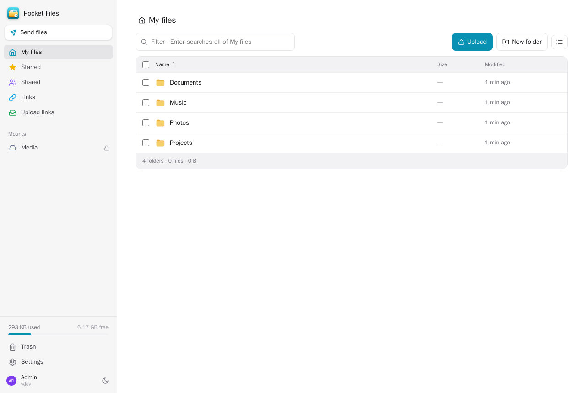
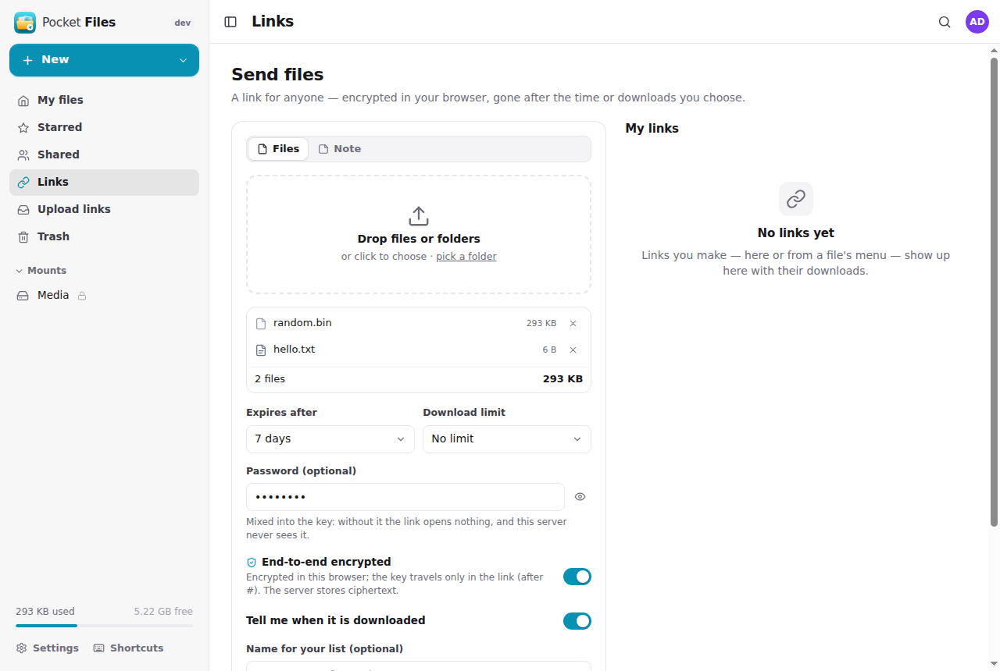
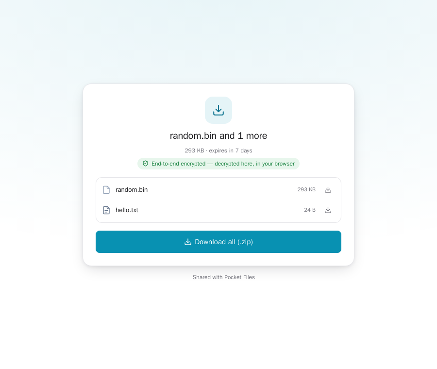
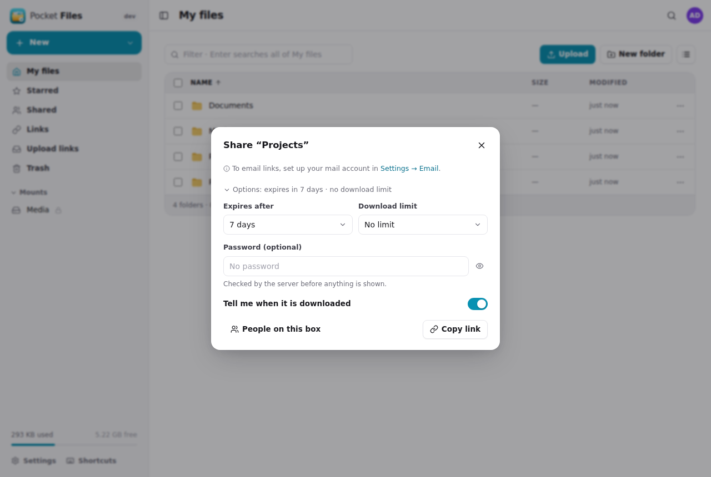
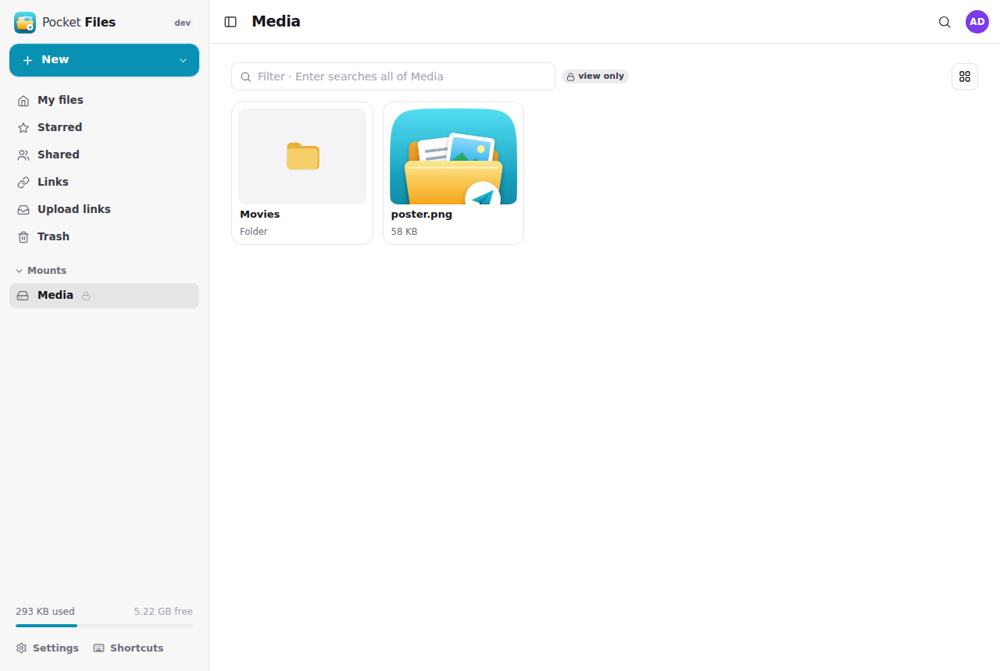
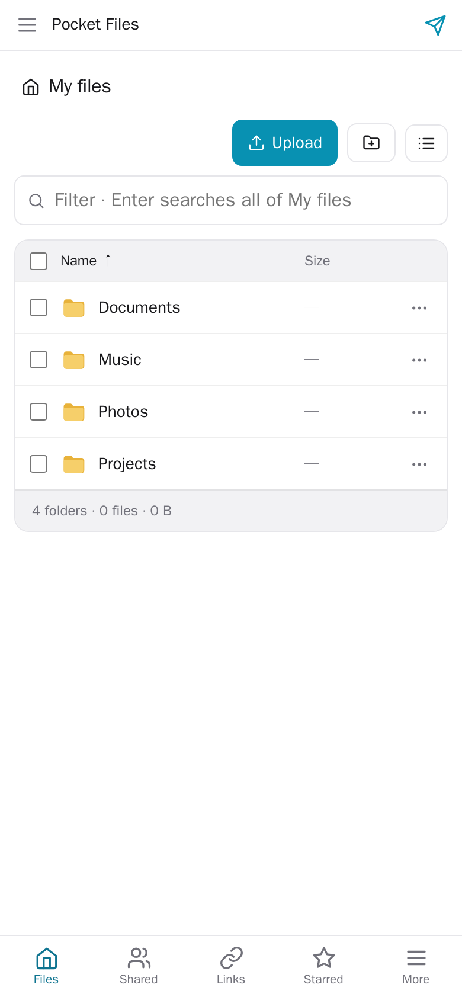
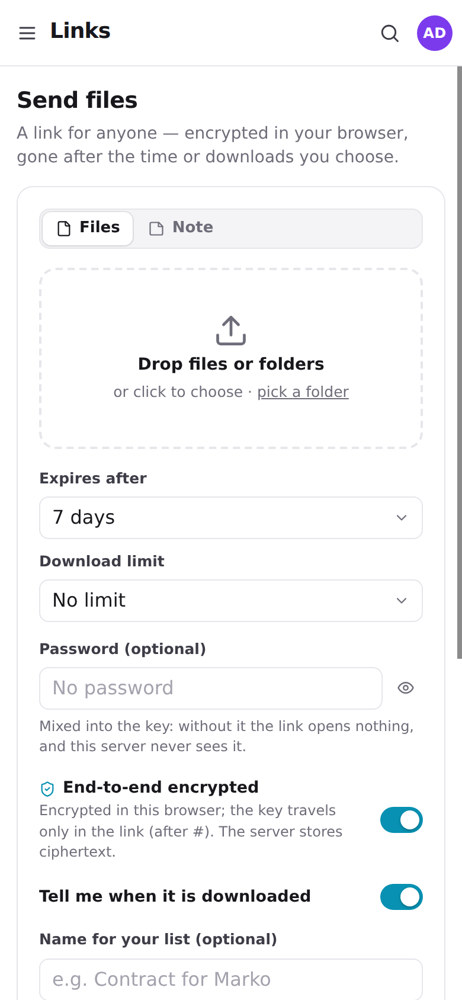

<p align="center"></p>
<h1 align="center">Pocket Files</h1>
<p align="center">Your files on your own server: a private home folder for everyone, server folders mounted for the household, folders shared between people, a WebDAV drive for every other app — and SkySend-style links, encrypted in the browser, that expire.<br>One Go binary, one SQLite file, one volume.</p>

Pocket Files is the file part of a self-hosted box without the weight of Nextcloud. Each person
gets a home folder nobody else can open — admins included. An admin can *mount* folders that
already live on the server (a media disk, a NAS share) and pick who sees them, read-only or not.
People share their own folders with each other. Anything can leave the box as a **link**: drop
files on the Send page and they are encrypted in your browser before they are uploaded, the key
rides in the link after `#`, and the link dies after the time or the number of downloads you
chose — the way [SkySend](https://github.com/Skyfay/SkySend) and Firefox Send work. And when you
need files *from* someone, an **upload link** lets them drop files straight into one of your
folders.

<p align="center"></p>

## Screenshots

<table>
  <tr>
    <td width="50%"></td>
    <td width="50%"></td>
  </tr>
  <tr>
    <td align="center"><sub>Drop files, choose expiry, downloads and a password, get a link.</sub></td>
    <td align="center"><sub>What the recipient sees — decrypted in their browser.</sub></td>
  </tr>
  <tr>
    <td width="50%"></td>
    <td width="50%"></td>
  </tr>
  <tr>
    <td align="center"><sub>Share any file or folder — with people here, or with a link.</sub></td>
    <td align="center"><sub>Server folders mounted for the household, with thumbnails.</sub></td>
  </tr>
</table>

<p align="center">
  &nbsp;&nbsp;
  
</p>

All screenshots use the built-in demo data. [How to refresh them](docs/screenshots/README.md).

## What it does

**Files**
- A home folder per person; folders and files with upload by drag and drop (folders included),
  a progress tray, rename, move and copy (also between places), delete to a trash with restore,
  stars, list and grid views with image thumbnails, sorting, a filter and a deep search.
- Preview images, video, audio, PDFs and text in the page; edit text files in place.
- Download a file, or any selection or folder as a zip streamed on the fly.

**Mounts — folders that already live on the server**
- Admins pick a folder below `MOUNT_ROOTS` (your media disk, a NAS mount) and give it a name.
- Everyone, or the people you pick, see it in the sidebar — each with *view* or *edit*; a mount can
  be read-only for all. Deletes in a mount are for good (no trash, the files are not ours).

**Shares between people**
- Share any folder or file of your home with people on the box — *can view* or *can edit* — or with
  everyone. It shows up under *Shared with me*, in their sidebar and in their WebDAV drive. What
  they delete lands in *your* trash.

**Links for anyone (sends)**
- **Upload and send**: files, whole folders, or a note (text, Markdown, code or a secret).
  End-to-end encrypted by default: AES-256-GCM in 64 KiB records, keys from HKDF over a random
  256-bit secret that only exists in the link's `#fragment`. The server stores ciphertext and never
  sees names, contents or the key. [Design](docs/security.md).
- **Share what is already here**: a live link to a file or folder (folders can be browsed and zipped
  by the recipient), or an encrypted copy of files.
- Every link: expiry (5 minutes to 30 days, or never), a download limit (one = burn after
  reading), an optional password (mixed into the key for encrypted links), a download log, and a
  notification when it is used. Extend, add downloads or kill a link at any time.
- **Email it in one click**: set up your mail account once (Settings → Email) and every link —
  new or existing, upload links too — goes out from your address; "Create & email" does both. The
  password never goes in the email.
- **Upload links (file requests)**: someone without an account drops files into a folder you
  choose — they never see what is there. Limits on file count and size, expiry, password. Files
  arrive in pieces, so links work through Cloudflare's 100 MB request cap.

**A drive for other apps**
- WebDAV at `/dav/` (and Nextcloud-shaped `/remote.php/dav/files/<user>/`): mount it in Finder,
  Windows, Files on iPhone, rclone. Your home is the root; *Shared with me* and *Mounts* are folders.
- With Pocket Core, other Pocket apps keep their files here instead of in Nextcloud: Pocket Office
  opens and saves documents, Pocket Documents files its archive, through the `files:read` and
  `files:write` links each person can switch off. [WebDAV and apps](docs/webdav.md).

**Two doors**
- The app on `PORT` (keep it private: LAN, VPN, Tailscale). With `PUBLIC_PORT` set, a second
  listener serves *only* the share and upload pages and their API — that is the one to put behind a
  tunnel. Everything else answers 404 there.

**Household**
- Built-in accounts, or *Sign in with Pocket Core* (zero configuration on a Pocket box), or any
  OpenID Connect provider, or a trusted proxy header. Strictly per person: other people's ids answer
  404, admins included.
- App passwords for WebDAV and scripts, Apprise / ntfy / webhook notifications, Core events
  (`files.uploaded`, `files.shared`, `files.send_downloaded`, `files.request_received`, …).

## Run it

```sh
docker run -d --name pocket-files -p 8080:8080 -p 8081:8081 \
  -e PUBLIC_PORT=8081 -e BASE_URL=https://files.example.com -e PUBLIC_URL=https://send.example.com \
  -v pocket-files:/data ghcr.io/abjelosevic88/pocket-homelab-files:latest
```

Open port 8080, create the first account (it becomes the admin). Or use
[`docker-compose.yml`](docker-compose.yml). To mount server folders, bind them into the container
at the same path and list their parent in `MOUNT_ROOTS`. All options:
[docs/configuration.md](docs/configuration.md). API: [docs/api.md](docs/api.md).

Without Docker: `make web build && ./pocket-files` (Go 1.26, Node 22).

## Build and test

```sh
make test     # go vet, go test, TypeScript
make run      # demo data, no login, on :8080 (+ share pages on :8081)
make dev      # API + Vite with hot reload
```

`scripts/e2e.mjs` drives the real UI in headless Chrome: uploads, an encrypted send with a password
opened as a stranger (the decrypted download is compared byte for byte), live links, mounts and an
upload link.

## License

MIT
